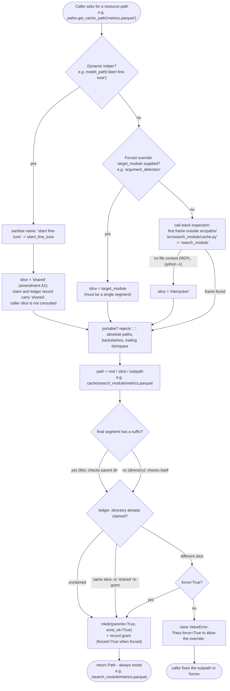

# Unified Path System v2 — usage patterns

Code layout in `src/paths/`:

```text
src/paths/
├── __init__.py      (public surface: paths, initialise, 3 getters, 4 dynamic helpers)
├── router.py        (PathRouter, paths singleton, initialise, module-level wrappers)
├── environment.py   (RepositoryEnvironment)
├── ledger.py        (GrantLedger, PathGrant)
└── core.py          (PathRoot, guards: escapes_root, portable_segments, sanitise_segment, single_segment)
```

## The routing rule

Every path the router hands out follows one shape:

```text
<root>/<module_slice>/<subpath>
```

| Root | `PathRoot` | Production default (platformdirs) |
|------|------------|-----------------------------------|
| data | `PathRoot.DATA` | `~/.local/share/Contradictor` |
| cache | `PathRoot.CACHE` | `~/.cache/Contradictor` |
| tmp | `PathRoot.TMP` | `tempfile.gettempdir()/Contradictor-<user>/` |

- `subpath=""` (or `"."`) → the module slice directory itself.
- `"metrics.parquet"` → a file inside the slice.
- `"sub/dir/out.json"` → nested below the slice.

Dynamic-name helpers (`model_path`, `cache_path`, `raw_dataset_path`, `processed_dataset_path`) are the one exception: 
they address shared root-level directories by design (`<data>/models/`, `<cache>/<name>`, …),
so their resolved shape is `<root>/<shared_subdirectory>/<name>` with no
module slice in between — see *Collisions* below.

## Request resolution flow




## Module slice derivation

Slice resolution order, per call:

1. **`target_module` override** — an explicit single segment for cross-module
   access (first-class feature, not an ACL bypass; spec Q3).
2. **Call-stack inspection** — the first stack frame outside `src/paths/`
   (never a hardcoded index). Its canonical id comes from
   `RepositoryEnvironment`: the anchor scans upward from the frame's
   `__file__` until a sentinel (`pyproject.toml` or `.git`) — **never from
   the process CWD**. The canonical id is the file's path relative to the
   repo root with the leading `src` stripped, `/`-joined
   (`src/search_module/cache.py` → `search_module/cache`). The **slice is
   the first component after `src`**; a top-level file (`main.py`) uses its
   stem. File renames never move a slice — only a directory change under
   `src/` does (spec Q2/D3).
3. **`interactive` fallback** — a frame without file context (REPL,
   `python -c`, synthetic frames) attributes the caller to the
   `interactive` slice.

## Creation on access (mkdir-on-access)

A returned path always exists — no "module X did not create it YET" errors
(spec Q5): every access runs `mkdir(parents=True, exist_ok=True)`,
concurrency-safe.

Suffix heuristic for the **final segment**:

- has a suffix (`.parquet`, `.json`, …) → treated as a **file**: only its
  parent directory is created;
- no suffix → treated as a **directory**: created itself.

So `get_cache_path("sub/out.json")` creates `<cache>/<slice>/sub/`, while
`get_cache_path("sub/results")` creates `<cache>/<slice>/sub/results/`.

## Guards (portability + sanitisation)

Every `subpath`, dynamic `name`, and `target_module` passes
`src/paths/core.py`:

- `portable_segments` rejects absolute paths, Windows drives, `..`
  segments, backslashes (a Windows separator), empty/`.` segments (they
  would be collapsed and silently rename the location), and trailing
  dot/space (Windows strips them).
- `sanitise_segment` (dynamic names only) replaces spaces and hyphens with
  `_` before the portability check.
- `target_module` and dynamic names must be a **single segment**
  (`single_segment`).

There is no permission/ACL layer (spec D6); these guards plus the ledger
below are the entire safety boundary.

## Collisions and `force=True` (spec Q7)

The router keeps a usage ledger of granted physical directories. When a
directory would be claimed by a **second, different module slice**, the call
raises `ValueError`:

```text
Directory <dir> is already claimed by module slice '<owner>'; module slice
'<claimant>' would silently share it. Pass force=True to allow the override.
```

Pass `force=True` to override; the override is recorded as a forced grant.
Nothing is ever silently shared, and re-claiming your **own** slice never
raises.

**Amendment A1 (spec §3, implemented):** the dynamic helpers (`model_path`,
`raw_dataset_path`, `processed_dataset_path`, `cache_path`) address shared
root-level directories (`<data>/models/`, …) by design, so their directory
claims — and their ledger records — are attributed to the `shared`
pseudo-slice, not to the caller's module slice; the caller is not consulted
at all. Two modules may therefore call the same helper freely without
`force=True`. `force=True` stays reserved for its intended case: a claim
colliding across a module slice and `shared` (in either order). Sliced
getters (`get_data_path` etc.) claim against the caller slice as before.

## Usage ledger

`paths.ledger` returns every grant as
`PathGrant(root_kind, module_slice, resolved_path, forced)`, in grant
order — for debugging and tests. Grants from the dynamic helpers carry
`module_slice="shared"` (amendment A1). The ledger lives in
`src/paths/ledger.py` (`GrantLedger`) and is cleared whenever `initialise()`
actually changes a root, because outstanding grants would refer to the
previous roots.

## Root injection: `initialise()` — the only sanctioned point

```python
from src.paths import initialise

initialise(
    data_root=Path("/data"),   # any argument omitted → that root is kept
    cache_root=Path("/cache"),
    tmp_root=Path("/tmp/contradictor"),
)
```

Used by `src/main.py` (production roots) and `tests/conftest.py` (test
isolation). Otherwise roots are resolved lazily from `Configuration`
(platformdirs, user-global) on first access. Calling `initialise()` with no
arguments is a safe no-op; it never creates directories in bulk — creation
happens on access (spec Q6, Q5).

## Test isolation (conftest)

The autouse `tests/conftest.py` fixture points all three roots into the
pytest tmp tree once per module: tests never touch the real machine, with
zero per-test work. Nothing else ever overrides roots (spec invariant 2, §4).

## Worked examples

```python
from src.paths import paths, model_path, raw_dataset_path

# inside src/search_module/...:
run_cache = paths.get_cache_path()                    # <cache>/search_module/
metrics   = paths.get_cache_path("metrics.parquet")   # .../search_module/metrics.parquet

# cross-module:
checkpoint = paths.get_cache_path(
    "checkpoint.pt", target_module="argument_detection"
)

# dynamic names (shared root-level directories):
model = model_path("sbert fine-tune")   # <data>/models/sbert_fine_tune
raw   = raw_dataset_path("claims")      # <data>/raw_datasets/claims
```

## API quick reference

| Call | Returns |
|------|---------|
| `paths.get_data_path(subpath="", target_module=None, *, force=False)` | `<data>/<slice>/<subpath>` |
| `paths.get_cache_path(subpath="", target_module=None, *, force=False)` | `<cache>/<slice>/<subpath>` |
| `paths.get_tmp_path(subpath="", target_module=None, *, force=False)` | `<tmp>/<slice>/<subpath>` |
| `paths.model_path(name, *, force=False)` | `<data>/<model_subdirectory>/<name>` |
| `paths.raw_dataset_path(name, *, force=False)` | `<data>/<raw_dataset_subdirectory>/<name>` |
| `paths.processed_dataset_path(name, *, force=False)` | `<data>/<preprocessed_dataset_subdirectory>/<name>` |
| `paths.cache_path(name, *, force=False)` | `<cache>/<name>` |

Module-level functions of the same names (`src.paths.get_cache_path`, …)
delegate to the `paths` singleton; `initialise()` overrides its roots.
