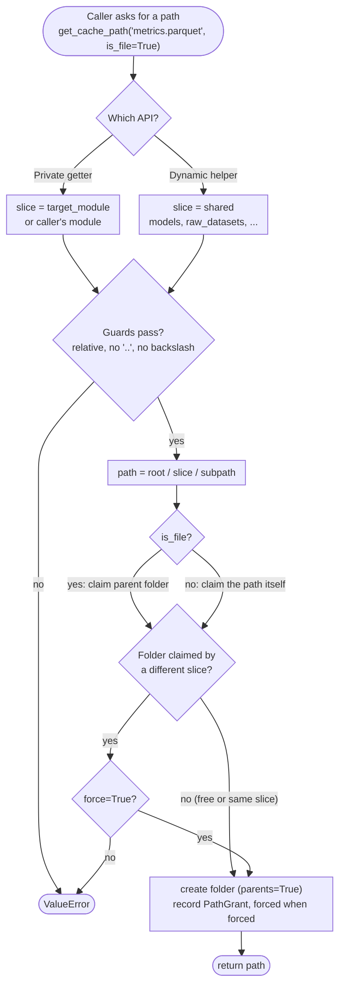

## Unified path system

Where which functionality lives:
```text
src/paths/
├── __init__.py      public surface: paths, initialise, getters, dynamic helpers
├── router.py        PathRouter, paths singleton, module-level wrappers
├── environment.py   RepositoryEnvironment
├── ledger.py        GrantLedger, PathGrant
└── core.py          PathRoot, guards
```

### Routing
Each request for a resource is resolved against a **Root**: the place where the resource belongs.

| Root | Production default (platformdirs) |
|------|-----------------------------------|
| data | `~/.local/share/Contradictor` |
| cache | `~/.cache/Contradictor` |
| tmp | `tempfile.gettempdir()/Contradictor-<user>/` |

Every request is checked against the caller's module. So there is a 1:1 mapping between modules and slice dirs. The two exceptions are the **shared** and **interactive** slices (see below).

```text
src/                                                ~/.local/share/Contradictor
├── argument_dataset            accesses                           ├── argument_dataset 
├── argument_detection      --------------------->                 ├── argument_detection 
├── argument_framing        (data root as example)                 ├── argument_framing 
└── nli                                                            └── nli  
```


Every path looks like: **`<root>/<module_slice>/<subpath>`**
```text
cache / search_module / sub/dir/out.json
└─root┘ └────slice────┘ └─────subpath─────┘
```

**Module slice** is the folder under a root that belongs to one module. For `src/search_module/...` the slice is `search_module`.

**Subpath** is the path inside that slice, like `sub/dir/out.json`. It can be empty, which means the slice folder itself.

---

### Types of module slices
Every module gets its own slice. There are three kinds. 

1. **Private**: your own module's slice. Use the getters.

```python
from src.paths import paths

# inside src/search_module/...
run_cache = paths.get_cache_path()                                 # <cache>/search_module/
metrics   = paths.get_cache_path("metrics.parquet", is_file=True)  # <cache>/search_module/metrics.parquet
```

- Getters: `get_data_path`, `get_cache_path`, `get_tmp_path`.
- Other module's slice: pass `target_module`.

```python
checkpoint = paths.get_cache_path(
    "checkpoint.pt", target_module="argument_detection", is_file=True
)  # <cache>/argument_detection/checkpoint.pt
```

2. **Shared**: fixed folders that all modules use. Use the dynamic helpers.

```python
from src.paths import cache_path, model_path, raw_dataset_path

model = model_path("sbert fine-tune")   # <data>/models/sbert_fine_tune    (file)
raw   = raw_dataset_path("claims")      # <data>/raw_datasets/claims       (folder)
tfidf = cache_path("tfidf")             # <cache>/tfidf                    (folder)
```

- Helpers: `model_path`, `raw_dataset_path`, `processed_dataset_path`, `cache_path`.
- The name must be one folder name. Spaces and hyphens become `_`.
- The folder names (`models`, `raw_datasets`, `processed_dataset`) come from `Configuration`.
- The caller's slice is never used, so there are no conflicts and no `force=True` needed.
- Claimed folder: `model_path` claims `<data>/models`, because a model is a file. The
  folder helpers claim `<data>/<subdir>/<name>`, not the shared parent — so
  `raw_dataset_path("claims")` and `raw_dataset_path("evidence")` coexist.
- `cache_path` is the exception: it has no shared subdirectory and resolves `<cache>/<name>`.

3. **Interactive**: the caller has no file. This happens in a REPL or with `python -c`. Everything goes into one folder.

```python
# python -c "from src.paths import paths; print(paths.get_cache_path('x.json', is_file=True))"
# <cache>/interactive/x.json
```

### How the slice is determined

The private getters pick the slice per call, in this order:

1. **`target_module`**: if you pass it, it wins. It must be one folder name, like `argument_detection`.
2. **Call stack**: walk up the callers. Skip anything inside `src/paths/` and any file outside the repo. The first file left decides the slice.
   - The repo root is the first folder above the file that has `pyproject.toml` or `.git`. Never the current directory.
   - Canonical id = the path inside the repo, without the leading `src`. `src/search_module/cache.py` → `search_module/cache`.
   - Slice = the first part of the canonical id: `search_module`.
   - A top-level file uses its name without the extension: `src/main.py` → `main`.
   - Renaming a file inside a folder keeps its slice. Renaming a top-level file changes it.
3. **No file left** (REPL, `python -c`): the slice is `interactive`.

---

### Ledger
The ledger is a record book. It keeps two things:
- **Claims**: which slice owns each folder. The first slice to use a folder owns it.
- **Grants**: one `PathGrant` for every path handed out.

Each `PathGrant` has:
- `root_kind`: data, cache or tmp
- `module_slice`: the slice that asked for the path
- `resolved_path`: the full path that was granted
- `forced`: `True` if `force=True` was used

`paths.ledger` returns the grants as a read-only tuple, in order. Use it for tests and debugging.

`initialise()` clears the ledger when a root changes — grants and claims both, plus the cached root map — because the old grants point to the old roots.

### Guards

Guards stop a path from leaving its root, and stop it from behaving differently on Windows and Linux. They check every `subpath`, dynamic `name`, and `target_module`.

- `portable_segments`: the path must stay inside its root. It rejects:
  - absolute paths, including Windows drive paths
  - `..`
  - backslashes (`\`)
  - empty or `.` parts, like `a//b`
  - a last part that ends with a dot or a space
- `sanitise_segment`: dynamic names only. Spaces and hyphens become `_`.
- `single_segment`: `target_module` and dynamic names must be one folder name.

Order is fixed, so the first error is deterministic:
- getters: `target_module` (or caller detection) → `subpath` → root resolution
- helpers: shared subdirectory → root resolution → `name`

Dynamic names are sanitised **before** validation: `sbert fine-tune` passes as
`sbert_fine_tune`, while `a/b` still fails.

There is no ACL layer. Guards + ledger are the whole safety boundary.

### Collisions

A folder can belong to one slice only. The ledger checks the folder before it is created:

- The same slice claims it again: fine.
- A different slice claims it: `ValueError`. No folder is created.
- `force=True`: the claim goes through, and the grant is recorded with `forced=True`. The first slice still owns the folder.

Only the exact same folder counts. A subfolder does not collide with its parent.

Shared helpers claim the `shared` slice. Any module can use them, so they never collide with each other, and `force` is not needed.

`force` is only for a private slice and `shared` claiming the same folder. For example, a module named `models` (`src/models/`) asks for `<data>/models`, which is the folder `model_path` uses. If either one comes second, it raises `ValueError`, unless one side passes `force=True`.

### Side effects per call

Applies to every call in [API](#api).

What each call claims:
```
Call asks for a folder ----> folder path
   (Folder is found)

Call asks for a file   ----> parent folder path
   (File is returned)

```

What happens on every call:

1. validates its arguments (order above) — nothing touches disk or ledger before it passes,
2. claims the folder, which is where a collision raises,
3. creates it with `parents=True`,
4. appends a `PathGrant` for the returned path (`forced=True` when `force=True` was used).

The file itself is never created. Roots resolve lazily on first access; a root
nobody injected keeps coming from `Configuration`.

### `initialise()` — the only root injection point

```python
from src.paths import initialise

initialise(
    data_root=Path("/data"),   # omitted argument → root kept
    cache_root=Path("/cache"),
    tmp_root=Path("/tmp/contradictor"),
)
```

Used by `src/main.py` (production) and `tests/conftest.py` (isolation).
No-arg call = safe no-op. No bulk mkdir — creation happens on access.
New roots apply on the next access; paths already handed out keep the old root.

## API

There are two types of calls in the table below:

- **Sliced getters** — `get_data_path`, `get_cache_path`, `get_tmp_path`. Return a path inside the caller's own slice, or inside the slice passed as `target_module`.
- **Dynamic helpers** — `model_path`, `raw_dataset_path`, `processed_dataset_path`, `cache_path`. Return a path in a shared location; the caller's slice is never used.

| Call | Returns |
|------|---------|
| `paths.get_data_path(subpath="", target_module=None, *, is_file=False, force=False)` | `<data>/<slice>/<subpath>` |
| `paths.get_cache_path(subpath="", target_module=None, *, is_file=False, force=False)` | `<cache>/<slice>/<subpath>` |
| `paths.get_tmp_path(subpath="", target_module=None, *, is_file=False, force=False)` | `<tmp>/<slice>/<subpath>` |
| `paths.model_path(name, *, force=False)` | `<data>/<model_subdirectory>/<name>` (file) |
| `paths.raw_dataset_path(name, *, force=False)` | `<data>/<raw_dataset_subdirectory>/<name>` |
| `paths.processed_dataset_path(name, *, force=False)` | `<data>/<preprocessed_dataset_subdirectory>/<name>` |
| `paths.cache_path(name, *, force=False)` | `<cache>/<name>` |

Module-level functions of the same names delegate to the `paths` singleton;
`initialise()` overrides its roots.

### Request resolution flow

